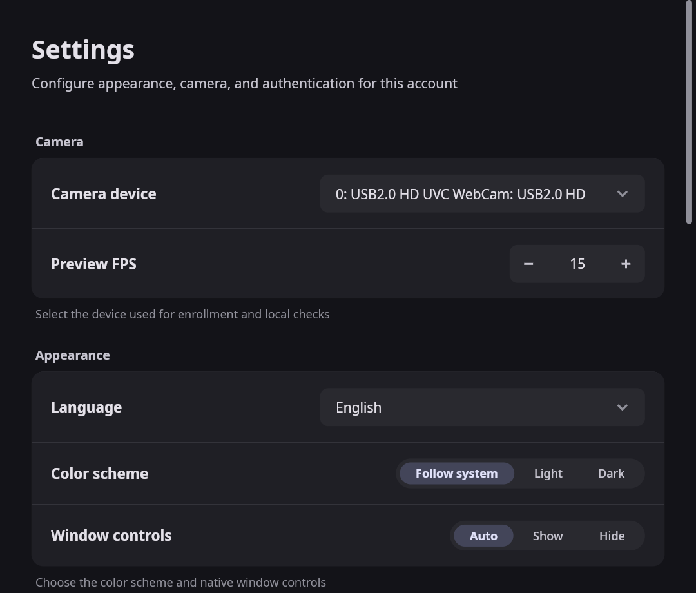
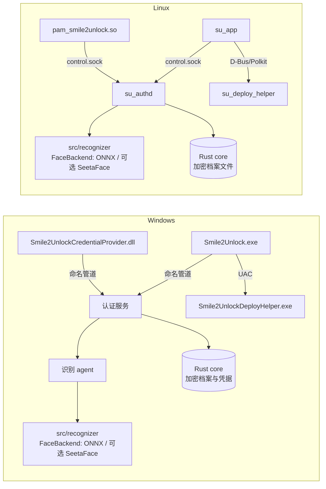

# Smile2Unlock

<p align="center">
  
</p>

<h3 align="center">本地人脸认证系统 · Windows 登录集成 + Linux PAM 认证</h3>

<p align="center">
  <a href="#项目简介">项目简介</a> •
  <a href="#软件截图">软件截图</a> •
  <a href="#平台">平台</a> •
  <a href="#部署">部署</a> •
  <a href="#架构">架构</a> •
  <a href="#仓库结构">仓库结构</a> •
  <a href="#构建">构建</a> •
  <a href="#贡献者">贡献者</a> •
  <a href="README.md">English</a>
</p>

<p align="center">
  
  
  
  
  
</p>

## 项目简介

Smile2Unlock 是一套**本地人脸认证系统**:人脸特征全部通过可插拔的本地识别后端提取与比对(默认使用 LightFacePipeline ONNX Runtime；SeetaFace 6 作为可选兼容后端保留在抽象层之下),不依赖任何云服务。它由两个平台变体组成:

- **Windows**:通过 Credential Provider 集成到 Winlogon 登录界面(锁定屏幕、UAC 提权界面)
- **Linux**:通过 PAM 模块接入 `login` / GDM / SDDM 等认证流程

两个平台共享同一套核心:C++26 modules 编写的识别流水线、Rust 编写的人脸档案存储(明文与加密两种后端)、Slint 编写的 GUI,以及 xmake 构建系统。

## 软件截图

下图为 Linux 桌面程序当前构建在 Xvfb 中的设置界面；截图裁去了账户侧栏和人脸资料。

<p align="center">
  
</p>

详细控制项见[功能与设置](docs/features.md)；开发、验证、文档和发布流程见
[维护手册](docs/maintenance.md)。

## 平台

### Windows

| 组件 | 形态 | 职责 |
| --- | --- | --- |
| `Smile2Unlock.exe` | Slint GUI | 人脸档案管理、预览、设置与部署面板；通过认证服务管理受保护档案 |
| `Smile2UnlockCredentialProvider.dll` | Rust CP | Winlogon 登录界面集成；向 LocalSystem 服务请求一次已认证登录 |
| `Smile2UnlockDeployHelper.exe` | UAC 提权助手 | Credential Provider 注册/注销、认证服务安装,由 GUI 面板触发 |
| `Smile2UnlockAuthService.exe` | LocalSystem 服务 | 持有加密人脸档案与账户凭据，并协调目标会话中的识别 |
| `Smile2UnlockRecognitionAgent.exe` | 会话工作进程 | 在目标登录会话打开摄像头，执行一次服务授权的识别 |
| `Smile2UnlockPasswordTool.exe` | 用户工具 | 保存或清除当前 Windows 账户的一份登录凭据 |

登录流程:锁定屏幕 → CP 磁贴 → 受 ACL 保护的命名管道 → LocalSystem 认证服务 → 目标会话识别 agent → 一次性登录凭据 → Windows LSA。GUI 不在锁屏认证边界内，全程不出本机。

### Linux

| 组件 | 形态 | 职责 |
| --- | --- | --- |
| `su_app` | Slint GUI | 人脸档案管理、识别预览,通过控制 socket 与守护进程通信 |
| `su_authd` | systemd 服务 | 认证守护进程,持有控制 socket(`/run/smile2unlock/control.sock`),执行识别与比对 |
| `pam_smile2unlock.so` | PAM 模块 | 登录时向 `su_authd` 发起认证请求 |
| `su_deploy_helper` | D-Bus + Polkit | 服务安装、PAM 配置等特权操作,由 GUI 面板触发 |

登录流程:登录界面 → PAM 认证钩子 → 控制 socket → `su_authd` 本地识别 → 认证结果返回 PAM。凭证存储密钥由 systemd 托管;同样全程不出本机。

## 部署

Windows 采用 **`bin\` + `assets\` 平级布局**:可执行文件(及其运行 DLL)放在 `bin\` 中,`assets\` 与它同级。Linux 按系统安装的 FHS 布局分散放置。

```text
Windows:  C:\su-deploy\
├── bin\                     # 可执行文件 + 运行 DLL
│   ├── Smile2Unlock.exe
│   ├── Smile2UnlockDeployHelper.exe
│   ├── Smile2UnlockCredentialProvider.dll
│   ├── Smile2UnlockAuthService.exe
│   ├── Smile2Unlock.ico
│   └── (onnxruntime / MinGW 运行库；若开启 --with_seetaface=y 则附带 SeetaFace 运行库)
└── assets\
    ├── i18n\
    │   ├── en.json
    │   └── zh-CN.json
    └── models\
        └── lightface\         # 开启 --with_seetaface=y 时也可使用 seeta\
            ├── detector_5pt_lcf.onnx
            ├── recognizer_edgeface.onnx
            ├── fas_spatial_enc.onnx
            └── fas_temporal_head.onnx

Windows 安全组件安装后:  C:\Program Files\Smile2Unlock\bin\

Linux(打包后):  /usr/bin/su_app
               /usr/libexec/smile2unlock/{su_authd,su_deploy_helper}
               /usr/lib/security/pam_smile2unlock.so
               /usr/share/smile2unlock/{i18n,models}
```

- 运行时可通过 `SU_RECOGNIZER_BACKEND=lightface|seetaface` 选择后端(编译启用时默认 LightFace)。模型目录按 `SU_MODEL_DIR`、后端专用变量(`SU_LIGHTFACE_MODEL_DIR` / `SU_SEETAFACE_MODEL_DIR`)、编译期宏、「从当前目录向上查找 `assets/models/<backend>`」的顺序解析;i18n 用同样的向上查找定位 `assets/i18n`(这正是 `bin\` + `assets\` 平级布局能工作的原因);Linux 系统安装后回退到 `/usr/share/smile2unlock/models/<backend>`
- Windows 解压后运行 `bin\Smile2Unlock.exe`,再在 GUI 的 **Deployment(部署)** 面板执行安装。提权 helper 会先把安全组件复制到 `C:\Program Files\Smile2Unlock\bin`,然后注册 CP 和服务；注册表不指向解压目录

## 架构



### 运行时角色

- **识别流水线**(`src/recognizer`):摄像头采集(V4L2 / Windows Media Foundation)与可插拔 `FaceBackend` 抽象层(默认 LightFacePipeline ONNX Runtime；可选 SeetaFace 6 兼容后端)实现检测 / 对齐 / 特征提取 / 活体检测,全部本地执行
- **Rust core**(`src/core-rs`):版本化 XChaCha20-Poly1305 档案与凭据封套；Windows 主密钥由 CNG TPM 保护，无 TPM 时回退 machine DPAPI，Linux 密钥由 systemd 托管
- **GUI**(`src/app`):Slint 界面 + 平台控制器；Windows 通过命名管道请求认证服务管理档案，Linux 通过 control socket 与 `su_authd` 交互

### 本地存储(两个平台一致)

**不使用 SQLite**:两个平台共用同一套 Rust core 存储——原子写入的私有文件:

| 数据 | 格式 | Linux | Windows |
| --- | --- | --- | --- |
| 应用配置 | TOML | `~/.config/smile2unlock/config.toml` | `%APPDATA%\smile2unlock\config.toml` |
| UI 偏好 | JSON | `~/.config/smile2unlock/ui.json` | `<exe 目录>\.smile2unlock-ui.json` |
| 人脸档案 | XChaCha20-Poly1305 封套内的 JSON | `/var/lib/smile2unlock/users/<uid>/profiles.s2u` | `%PROGRAMDATA%\smile2unlock\users\<sid>\profiles.s2u` |

平台差异仅在于目录惯例(XDG vs `%APPDATA%`、`/var/lib` vs `%PROGRAMDATA%`);文件格式与 Rust core 代码路径完全相同。Linux 写入为 `0600` + fsync,Windows 用 `MoveFileExW` 原子替换。

两个平台的秘密数据都用 `zeroize` 清零。Linux `su_authd` 的主密钥放在页对齐的 `mmap` 中:`mlock` 锁页、标记 `MADV_DONTDUMP`、空闲时用 `mprotect(PROT_NONE)` 封存——与 Windows Credential Provider 使用的 vendored `memsafe` fork 提供的空闲封存(锁定 + `PAGE_NOACCESS`)同一语义;LogonUI 内密码/密钥另有锁定 + `PAGE_NOACCESS` 保护。密钥读取是限定在消费调用内(`with_bytes` / `with_context`)的临时 `PROT_READ` 提升。

## 仓库结构

```text
.
|-- src/
|   |-- app/                  # su_app GUI 入口 + 平台控制器
|   |-- modules/              # C++26 modules(su.core.* / su.app.* / su.recognizer.*)
|   |-- core-rs/              # Rust 档案存储与加密
|   |-- recognizer/           # FaceBackend(LightFace ONNX + 可选 SeetaFace)、摄像头、图像流水线
|   |-- platform/
|   |   |-- windows/          # Rust CP、认证服务、识别 agent、部署助手
|   |   `-- linux/            # authd、PAM、部署助手
|   `-- zig/                  # Zig 组件
|-- assets/                   # 唯一资源目录:icons / i18n / models/{lightface,seeta}
|-- packaging/                # Linux(package.sh、systemd、dbus、polkit)+ Windows(package.sh)
|-- docs/                     # 设计文档
|-- xmake/repo/               # 项目内置 xmake 包仓库(ONNX Runtime)
|-- local-repo/               # 本地 xmake 包仓库(Slint、可选 SeetaFace6)
|-- NOTICE/                   # 第三方声明
`-- xmake.lua                 # 构建入口
```

## 构建

构建默认启用 **LightFace ONNX Runtime** 后端(`with_lightface=y`、`with_seetaface=n`,通过 `xmake/repo/` 获取官方 CPU 预编译库)。默认 ONNX 模型由 [LightFacePipeline Releases](https://github.com/Smile2Unlock/LightFacePipeline/releases) 托管，发行安装包均默认内嵌模型；未使用 Git LFS 检出源码时，可执行 `bash packaging/models/fetch-models.sh` 下载并按 SHA-256 校验。

### Windows(交叉编译或原生)

```bash
bash packaging/slint/setup-rust.sh --target x86_64-pc-windows-gnu
bash packaging/slint/seed-slint-mingw.sh
bash packaging/models/fetch-models.sh
xmake f -y -p mingw -a x86_64 -m release
xmake build
```

Windows Credential Provider 由 Rust 构建:

```bash
xmake build su_credential_provider
```

主要产物位于 `build/mingw/x86_64/release/`:包括 `Smile2Unlock.exe`、`Smile2UnlockDeployHelper.exe`、`Smile2UnlockCredentialProvider.dll`、`Smile2UnlockAuthService.exe`、`Smile2UnlockRecognitionAgent.exe` 和 `Smile2UnlockPasswordTool.exe`。

### Linux

```bash
bash packaging/slint/setup-rust.sh
bash packaging/models/fetch-models.sh
xmake f -y -p linux -a x86_64 -m release
xmake build
```

若需同时编入可选 SeetaFace6 兼容后端，可在配置时传入 `--with_seetaface=y`(并通过 `SU_RECOGNIZER_BACKEND=seetaface` 切换运行，SDK 配方由 `local-repo/` 提供)。

从现有 Release 产物打包并验证两个平台:

```bash
packaging/package.sh --platform all
```

需要重新配置、构建、打包并验证时:

```bash
packaging/package.sh --platform all --build
```

Linux 原生格式可用 `--linux-format pacman`、`deb`、`rpm` 或 `all`。安装包会内嵌包含版本、平台、架构和文件校验值的 `release-info.json`，且不会修改仓库中的受跟踪文件。详细布局和验证约定见 [`packaging/README.md`](packaging/README.md)。

当前实现状态和发布前待办见 [`docs/current_status.md`](docs/current_status.md)。
正式发布版本由 `vX.Y.Z` Git tag 决定，无需为版本号单独提交 PR；本地覆盖方式见
[`packaging/README.md`](packaging/README.md)。

## 贡献者

主程序侧边栏的**关于**页显示构建版本、下列贡献者和第三方组件的许可摘要。
文档阅读区内置项目许可证、第三方声明及 `licenses/` 中的全部文本，可离线查看。
新增贡献者或组件摘要时更新 `assets/about/credits.json`；许可证文档在 Xmake
构建时自动嵌入。

**代码贡献**

- [ation_ciger](https://github.com/aurorae114514)
- [dullspear](https://github.com/dullspear)

**Logo 设计**

- [YAUE](https://space.bilibili.com/1258455455)

## 安全说明

本项目涉及 Windows/Linux 认证表面与本地面部生物特征数据。请在使用前仔细审查代码;生产部署需要专门的安全评审、防欺骗评估与生物特征数据的生命周期管理。

## 许可证

[MIT License](LICENSE)

第三方归属与声明见 [NOTICE/THIRD-PARTY-NOTICES.md](NOTICE/THIRD-PARTY-NOTICES.md)。
